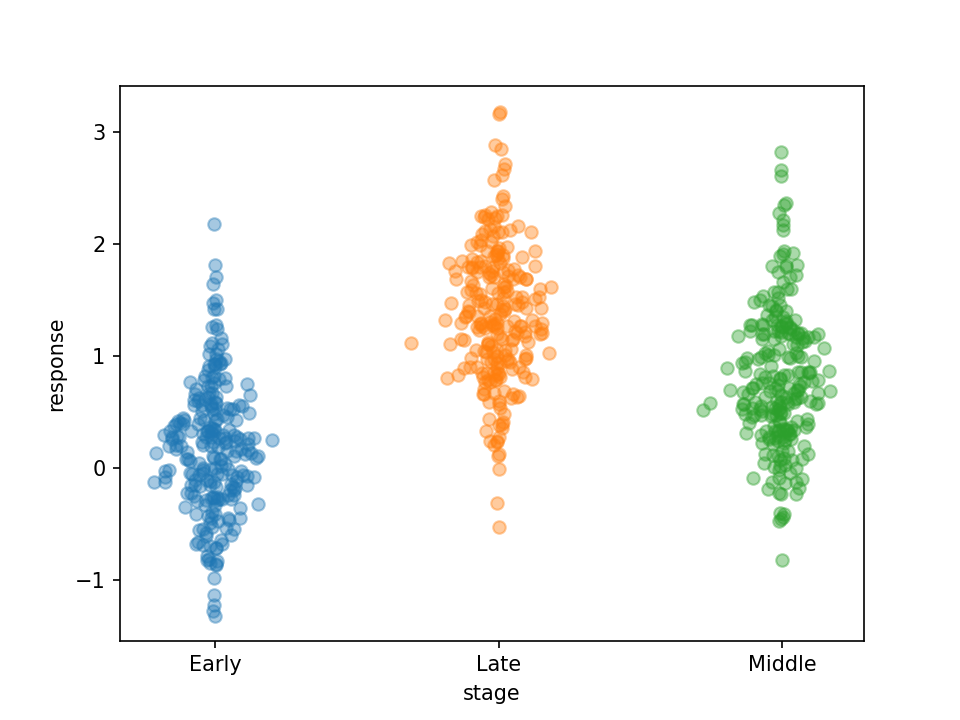

# Postaplot

[](https://github.com/mwappner/postaplot/actions/workflows/ci.yml)

When you’re comparing groups for the first time, it helps to see both the shape of each distribution and the observations behind it. A POSTA plot shows one dot per observation. Each dot stays at its measured value and moves only along the axis that separates the groups, with more room to spread where observations are concentrated.

With a few observations, you can read the dots much as you would in a strip or swarm plot. With larger samples, the cloud takes on a shape you can read like a violin plot. Add a boxplot to see the median and quartiles alongside the individual values. That makes a POSTA plot a useful default for exploring data across groups, even when some groups have many more observations than others.

The main `postaplot()` function borrows its API from Seaborn’s `violinplot()`. Use familiar arguments like `x`, `y`, `hue`, `order`, `dodge`, and `split` to build the same kinds of group comparisons with dots. POSTA stands for **Presentation Of Sincere Total Adquisitions**.



## Installation

Postaplot requires Python 3.10 or newer and Matplotlib 3.10 or newer.

```bash
python -m pip install postaplot
```

## Quickstart

```python
import matplotlib.pyplot as plt
import numpy as np
import pandas as pd
from postaplot import postaplot

rng = np.random.default_rng(7)
data = pd.DataFrame({
    "group": np.repeat(["Control", "Treated"], 120),
    "response": np.r_[rng.normal(0, 0.6, 120), rng.normal(0.5, 0.8, 120)],
})

postaplot(data, x="group", y="response", box=True, seed=7)
plt.show()
```

## Features

- **Compare subgroups.** Use discrete `hue` to draw [overlapping, dodged, or split clouds](docs/cookbook.md#compare-overlapping-dodged-and-split-clouds). Set the [category and hue order](docs/cookbook.md#order-categories-and-hue-levels) when the comparison has a natural sequence.
- **Color by a measurement.** Pass a continuous variable to `hue` and use a colorbar to read the values.
- **Show summary statistics.** Overlay boxplots with `box=True` and [customize their appearance](docs/cookbook.md#add-and-style-boxplots) with `box_kwa`.
- **Adjust the layout.** Draw vertical or horizontal clouds, use [`width` and `gap`](docs/cookbook.md#adjust-width-and-spacing) to control the space within each category.
- **Tune how the points spread.** Estimate the local concentration of observations with KDE or a histogram, and choose normal or uniform jitter.
- **Style the points.** Customize marker shape, size, and transparency, or use hollow markers where points overlap.

## Documentation

The [cookbook](docs/cookbook.md) walks through layouts, ordering, spacing, boxplot styling, and custom marker colors.

- `postaplot_columns()` draws a cloud for each column in a wide DataFrame or each entry in a dictionary of named arrays. The arrays can have different lengths.
- `postaplot_engine()` draws a single cloud at a position you choose in a custom Matplotlib layout. You can use it to set different marker shapes for each subgroup or map marker faces and edges separately.

## License

Postaplot is distributed under the MIT License. Copyright © 2025 postaplot authors. See the [LICENSE file](LICENSE) for the license text.
