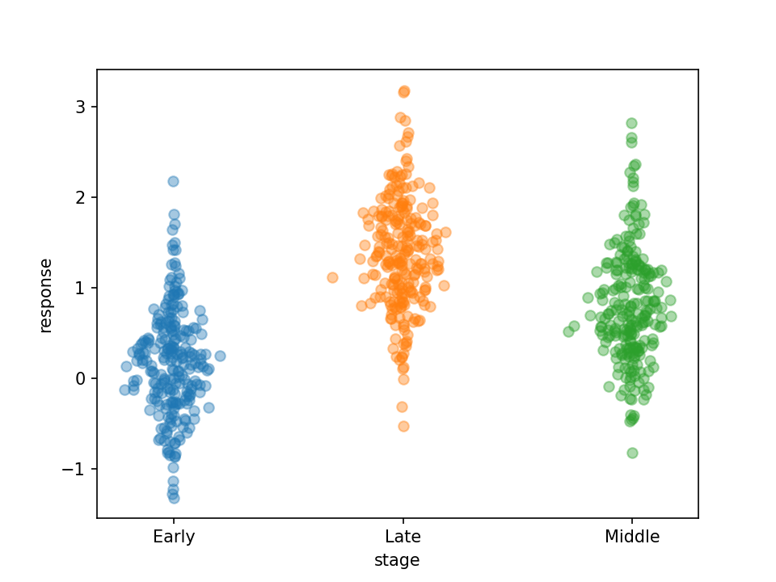

# Postaplot

When you’re comparing groups for the first time, it helps to see both the shape of each distribution and the observations behind it. A POSTA plot shows one dot per observation. Each dot stays at its measured value and moves only along the axis that separates the groups, with more room to spread where observations are concentrated.

With a few observations, you can read the dots much as you would in a strip or swarm plot. With larger samples, the cloud takes on a shape you can read like a violin plot. Add a boxplot to see the median and quartiles alongside the individual values. That makes a POSTA plot a useful default for exploring data across groups, even when some groups have many more observations than others.

The main `postaplot()` function borrows its API from Seaborn’s `violinplot()`. Use familiar arguments like `x`, `y`, `hue`, `order`, `dodge`, and `split` to build the same kinds of group comparisons with dots. POSTA stands for **Presentation Of Sincere Total Adquisitions**.



## Installation

Postaplot requires Python 3.10 or newer and Matplotlib 3.10 or newer.

```bash
python -m pip install postaplot
```

## Quickstart

```python
import matplotlib.pyplot as plt
import numpy as np
import pandas as pd
from postaplot import postaplot

rng = np.random.default_rng(7)
data = pd.DataFrame({
    "group": np.repeat(["Control", "Treated"], 120),
    "response": np.r_[rng.normal(0, 0.6, 120), rng.normal(0.5, 0.8, 120)],
})

postaplot(data, x="group", y="response", box=True, seed=7)
plt.show()
```

## Documentation

See the [cookbook](https://github.com/mwappner/postaplot/blob/main/docs/cookbook.md) for examples of split and dodged plots, ordering, and styling. Visit the [GitHub repository](https://github.com/mwappner/postaplot) for the source and issue tracker.

## License

[MIT](https://github.com/mwappner/postaplot/blob/main/LICENSE)
