# Postaplot cookbook

A postaplot shows individual observations as a cloud whose width follows the estimated density. Each dot keeps its measured value and moves only along the categorical axis.

## Start with a DataFrame

Run this setup once. The examples below reuse the same data and imports.

```python
import matplotlib.pyplot as plt
import numpy as np
import pandas as pd
from matplotlib.colors import CenteredNorm
from postaplot import postaplot, postaplot_columns, postaplot_engine

rng = np.random.default_rng(12)
data = pd.concat(
    [
        pd.DataFrame({
            "stage": stage,
            "condition": condition,
            "response": rng.normal(mean + shift, spread, 120),
        })
        for stage, mean in [("Early", 0), ("Late", 1.2), ("Middle", 0.6)]
        for condition, shift, spread in [
            ("Control", 0, 0.45),
            ("Treated", 0.35, 0.70),
        ]
    ],
    ignore_index=True,
)
data["score"] = data["response"] + rng.normal(0, 0.35, len(data))
```

```python
fig, ax = plt.subplots()
postaplot(data, x="stage", y="response", seed=7, ax=ax)
```

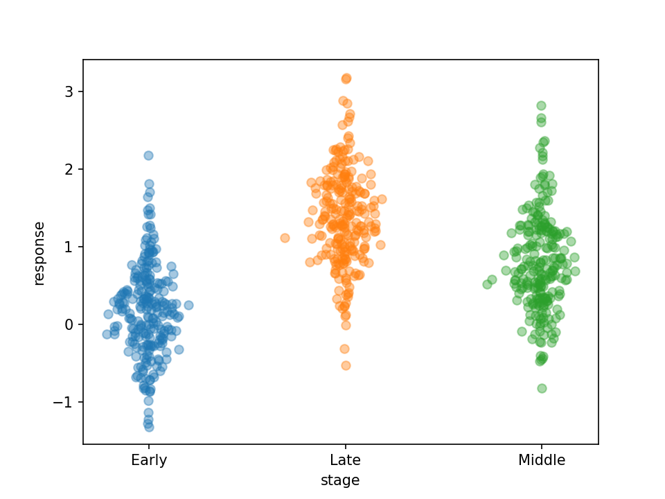

## Order categories and hue levels

`order` sets the category order on the axis. `hue_order` sets the hue order in the legend and, with `dodge=True`, the order of the clouds within each category.

```python
stage_order = ["Early", "Middle", "Late"]
condition_order = ["Treated", "Control"]
palette = {"Control": "goldenrod", "Treated": "darkseagreen"}

fig, ax = plt.subplots()
postaplot(
    data, x="stage", y="response", hue="condition",
    order=stage_order, hue_order=condition_order, palette=palette,
    dodge=True, width=0.7, gap=0.15, seed=7, ax=ax,
)
```

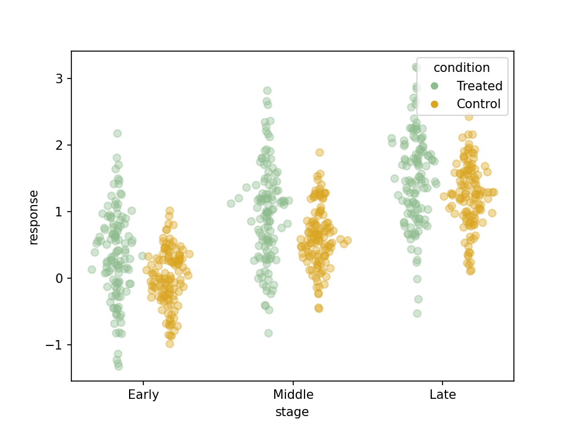

## Compare overlapping, dodged, and split clouds

By default, hue levels share a cloud and are distinguished by color. Dodging places full clouds side by side. Splitting draws half clouds. With two hues, the halves face away from the category center.

```python
fig, axes = plt.subplots(1, 3, figsize=(12, 4), sharey=True, layout="constrained")
for ax, layout, title in [
    (axes[0], {}, "Overlapping"),
    (axes[1], {"dodge": True}, "Dodged"),
    (axes[2], {"split": True}, "Split"),
]:
    postaplot(
        data, x="stage", y="response", hue="condition",
        order=stage_order, hue_order=condition_order, palette=palette,
        width=0.7, seed=7, ax=ax, **layout,
    )
    ax.set_title(title)
```

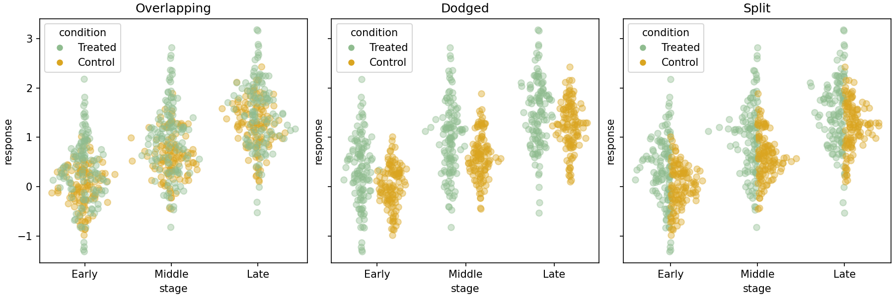

With no hue or one hue level, splitting draws a single half cloud. With more than two discrete hue levels, the halves sit side by side and alternate direction in hue order. `split_side` chooses the direction of the first half.

## Draw a horizontal half cloud

Put the measured values on x and the categories on y. Here `split_side="positive"` draws each half cloud above its category position.

```python
fig, ax = plt.subplots()
postaplot(
    data, x="response", y="stage", order=stage_order,
    orient="h", split=True, split_side="positive", seed=7, ax=ax,
)
```

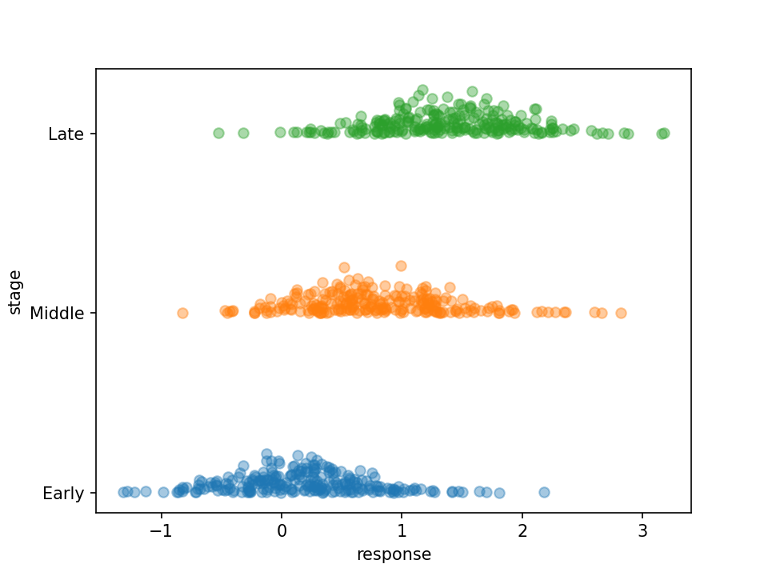

## Adjust width and spacing

`width` sets the total space for each category. Increasing it spreads the centers of dodged clouds farther apart and widens the clouds. `gap` narrows each cloud within its slot while keeping the slot centers fixed.

```python
fig, axes = plt.subplots(1, 3, figsize=(11, 3.5), sharey=True, layout="constrained")
for ax, width, gap in zip(axes, [0.4, 0.8, 0.8], [0, 0, 0.3]):
    postaplot(
        data, x="stage", y="response", hue="condition",
        order=stage_order, hue_order=condition_order, palette=palette,
        dodge=True, width=width, gap=gap, reference=ax is axes[0],
        seed=7, ax=ax,
    )
    ax.set_title(f"width={width}, gap={gap}")
```

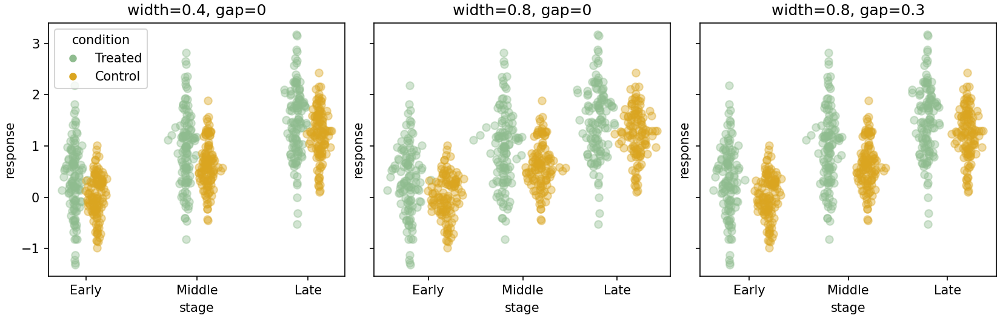

## Add and style boxplots

Use `box=True` to overlay boxplots. Pass box styling in `box_kwa` and marker styling directly to `postaplot()`.

```python
fig, axes = plt.subplots(1, 2, figsize=(9, 4), sharey=True, layout="constrained")
for ax, options, title in [
    (axes[0], {}, "Default boxes"),
    (axes[1], {
        "marker": "D", "markersize": 3, "alpha": 0.55, "hollow": True,
        "box_kwa": {
            "boxprops": {"facecolor": "whitesmoke", "edgecolor": "0.3"},
            "medianprops": {"color": "red", "linewidth": 2},
            "showfliers": False,
        },
    }, "Custom boxes and markers"),
]:
    postaplot(
        data, x="stage", y="response", hue="condition",
        order=stage_order, hue_order=condition_order, palette=palette,
        split=True, width=0.7, gap=0.15, box=True, seed=7, ax=ax,
        **options,
    )
    ax.set_title(title)
```

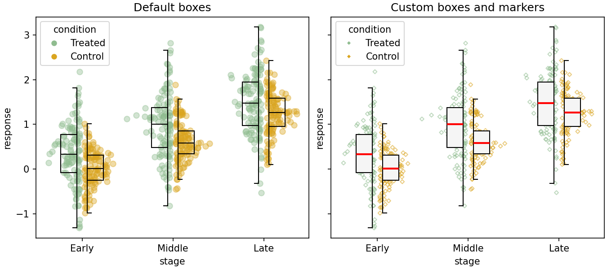

## Control the cloud shape

`width` sets the space allotted to a category. Normal jitter can extend beyond that space. Change `width_distr` to choose how dots spread across the cloud, or `width_method` to change how density determines the spread.

```python
fig, axes = plt.subplots(1, 3, figsize=(10, 3.5), sharey=True, layout="constrained")
for ax, distribution, method, title in [
    (axes[0], "normal", "kde", "Normal · KDE"),
    (axes[1], "uniform", "kde", "Uniform · KDE"),
    (axes[2], "uniform", "histogram", "Uniform · histogram"),
]:
    postaplot(
        data, x="stage", y="response", order=stage_order,
        width=0.65, width_distr=distribution, width_method=method,
        seed=7, ax=ax,
    )
    ax.set_title(title)
```

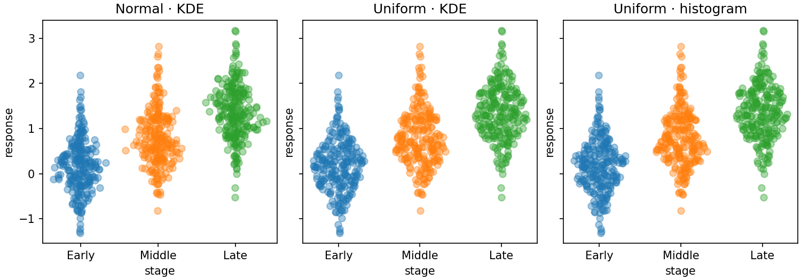

## Color points by a numeric variable

Continuous hue uses a colorbar. Here a diverging colormap is centered at zero, and `hollow=True` applies the color to the marker edges. Use `reference=False` to hide the legend or colorbar.

```python
fig, axes = plt.subplots(1, 2, figsize=(9, 4), sharey=True, layout="constrained")
for ax, reference in zip(axes, [True, False]):
    postaplot(
        data, x="stage", y="response", hue="score", order=stage_order,
        palette="coolwarm", hue_norm=CenteredNorm(vcenter=0),
        hollow=True, markersize=4, reference=reference, seed=7, ax=ax,
    )
    ax.set_title("With colorbar" if reference else "Without colorbar")
```

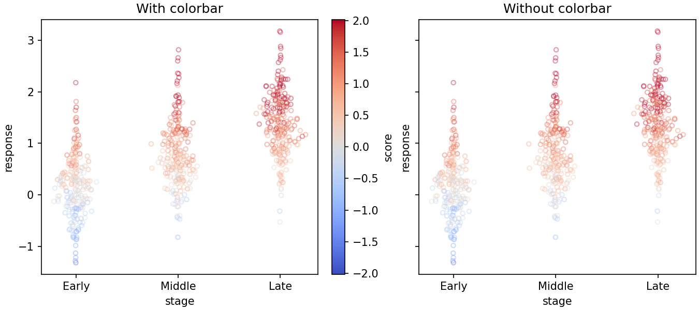

## Plot one cloud per column

`postaplot_columns()` is a shortcut for plotting a wide DataFrame, with one cloud per column, or a dictionary with columns as values, possibly with different lengths.

```python
wide = data.pivot(columns="stage", values="response").loc[:, stage_order]
fig, ax = plt.subplots()
postaplot_columns(wide, ax=ax, rng=np.random.default_rng(7))
```

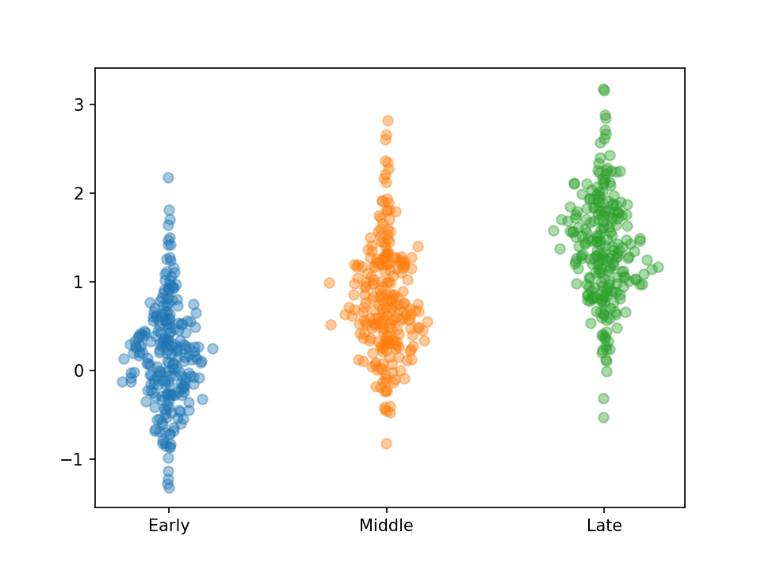

## Advanced recipes

### Map marker faces and edges separately

Use `postaplot_engine()` to draw one cloud at a position you choose. It returns the Matplotlib scatter collection. Pass per-point colors to `facecolors` and `edgecolors` to show two variables on the same dots. Here faces encode score and edges encode condition.

```python
middle = data.loc[data["stage"] == "Middle"]
cmap = plt.get_cmap("coolwarm")
norm = CenteredNorm(vcenter=0)
facecolors = cmap(norm(middle["score"].to_numpy()))
edgecolors = middle["condition"].map(palette).to_numpy()

fig, ax = plt.subplots()
cloud = postaplot_engine(
    loc=2, series=middle["response"], ax=ax,
    facecolors=facecolors, edgecolors=edgecolors,
    rng=np.random.default_rng(7),
    alpha=0.9, markersize=10, markeredgewidth=2
)
ax.set(xticks=[2], xticklabels=["Middle"], ylabel="response")
fig.colorbar(
    plt.cm.ScalarMappable(norm=norm, cmap=cmap),
    ax=ax, label="score"
)
ax.legend(handles=[
    plt.Line2D(
        [], [], marker="o", linestyle="none", color="0.9",
        markeredgecolor=palette[level], markeredgewidth=2,
        label=level,
    )
    for level in condition_order
], title="condition")
```

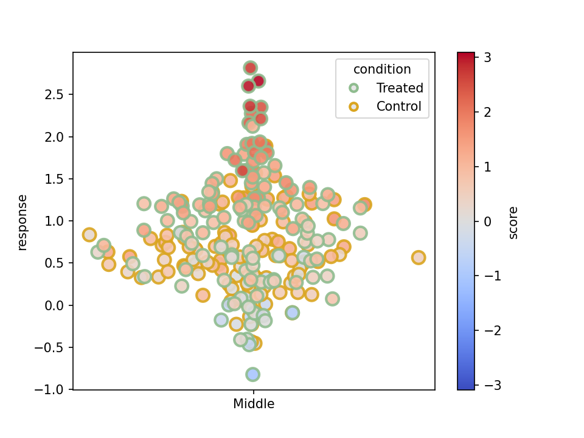

### Use different markers for each hue

Draw one cloud per hue to set the marker shape separately. Here both clouds share a position. Each call estimates the density for its own observations.

```python
fig, ax = plt.subplots()
markers = {"Treated": "D", "Control": "o"}
jitter_rng = np.random.default_rng(7)

for condition in condition_order:
    values = middle.loc[middle["condition"] == condition, "response"]
    postaplot_engine(
        loc=0, series=values, ax=ax, rng=jitter_rng,
        color=palette[condition], marker=markers[condition],
        markersize=10, label=condition, alpha=0.9, markeredgecolor="none",
    )

ax.set(xticks=[0], xticklabels=["Middle"], ylabel="response")
ax.legend(title="condition")
```

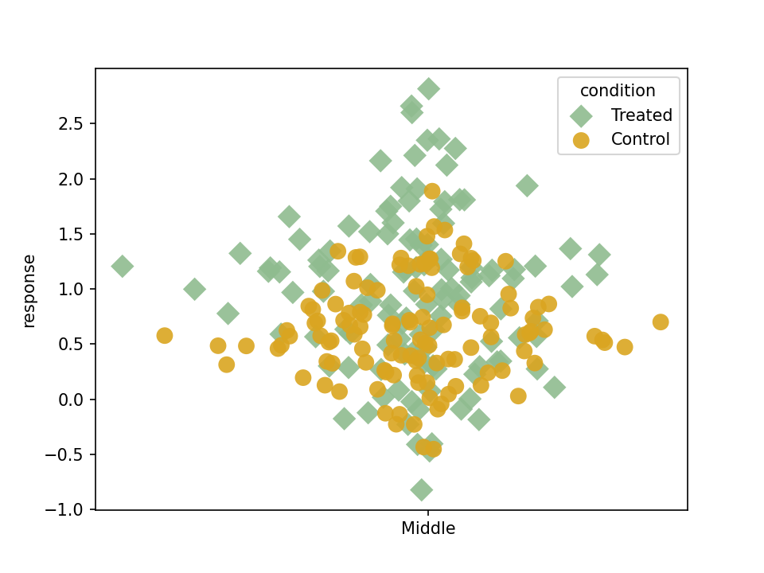
